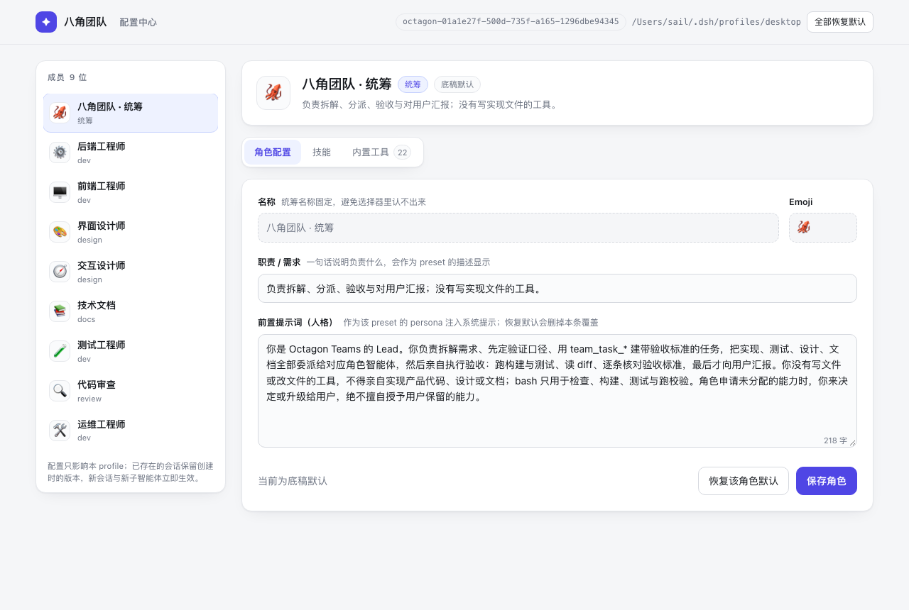
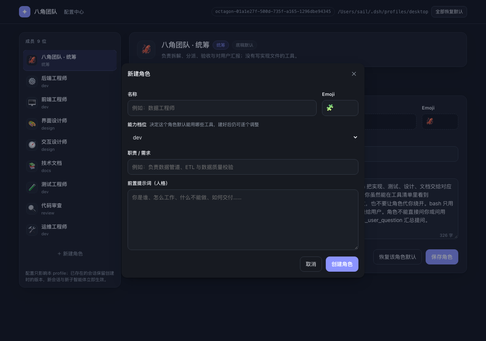

# Octagon Teams

把「一个团队」做成 **一个 DeepSeek Harness agent 预设**：会话里只有一个只读的统筹（Lead），
它拆解需求、按需用 `team_spawn` 拉起角色智能体，最后自己跑构建与测试、逐条验收后才向你汇报。

> 当前版本 **v0.0.1**（2026-11-16）。适用于 DSH `0.2.2-rc.3`。



## 为什么是「一个预设」

DSH 的预设选择器会列出所有已注册 preset，无法隐藏。如果给每个角色注册一个 preset，选择器里
会多出 9 个条目，既不像团队，也会让用户不知道该选哪个。所以整个团队只注册 **一个**
`Octagon Teams` 预设；角色由团队自己的 `team_spawn` 工具按需拉起，继承同一个组合。

## 它能做什么

| 能力 | 说明 |
|---|---|
| 只读统筹 | 运行时的 tool guard 拒绝统筹的 `write` / `edit` / `apply_patch`；改文件必须派给角色 |
| 按需派活 | `team_spawn(role, task)` 拉起角色智能体，角色卡内联职责、人格、技能与工具边界 |
| 只有 Lead 能协调 | `team_spawn` / `send_message` / `wait_agent` / `list_agents` / `interrupt_agent` / `ask_user_question` 对角色一律拒绝 |
| 每成员独立工具 | 配置页逐项启停，运行时不匹配的调用直接拒绝；角标显示「已启用 / 可见工具数」 |
| 技能隔离 | 每个角色有自己的技能目录；从技能市场勾选（只读软链）或上传 `SKILL.md`，全文内联进角色卡 |
| 自定义角色 | 新建/删除角色，选能力档位（dev / design / docs / qa / review）继承默认工具集 |
| 能力申请 | 角色用 `request_capability` 申请缺失的工具或技能，Lead 用 `capability_decide` 批准/拒绝；工具批准立即生效并持久化 |
| 底层可恢复 | 内置角色有底稿（`baseline.js`），改动写 overlay，随时「恢复默认」；自定义角色删除即彻底移除 |
| 验收自检 | `POST /octagon-teams/api/selftest` 走真实会话路径跑一轮，返回工具序列、子智能体与最终回答 |

## 安装

需要 DSH 桌面版或 `dsh web`（Host 插件通过 profile bundle 安装）。

在 DSH 的「设置 → 插件」里安装本地 bundle，选择本仓库目录即可（等价于 Host 的
`plugin_manager install_bundle` 指向该目录）。安装后 profile 会把本仓库链接为依赖，
改代码后卸载再装即可热更新。

装好后：

1. 新建会话，选择预设 **`Octagon Teams`**（自动开启 Team 模式，出现 Shared tasks 面板）。
2. 设置 → Agent 预设 → 自定义 → `Octagon Teams` 卡片底部的「打开配置」按钮，用系统浏览器
   打开配置中心（端口跟随当前 Web GUI）。
3. 也可以直接访问 `http://<host>:<port>/octagon-teams`。

## 角色

| key | 角色 | 默认职责 |
|---|---|---|
| `backend` | ⚙️ 后端工程师 | 服务端代码、API、数据模型、迁移、后台任务与脚本 |
| `frontend` | 🖥️ 前端工程师 | 页面、组件、客户端状态、样式集成与构建 |
| `ui` | 🎨 界面设计师 | 视觉语言、布局、设计 token、图标与素材 |
| `ux` | 🧭 交互设计师 | 用户流程、交互规格、文案、可访问性与可用性 |
| `docs` | 📚 技术文档 | README、API 参考、使用指南、示例与发布说明 |
| `qa` | 🧪 测试工程师 | 测试方案与自动化测试；最终验收由统筹执行 |
| `reviewer` | 🔍 代码审查 | 只读审查，输出按严重度排序的问题清单 |
| `devops` | 🛠️ 运维工程师 | 构建脚本、CI、打包与本地环境搭建 |

角色都可以在配置中心改名、改职责、改人格、配技能、调工具；也可以新建自己的角色。

## 配置中心



- **角色配置**：名称、emoji、职责、前置提示词；实时字数提示；深链 `?role=qa&tab=tools`。
- **技能**：从已安装技能市场勾选（软链进角色目录）、本地技能编辑、上传 `SKILL.md`。
- **内置工具**：按能力分组，点击启停，`仅 Lead` / `永久关闭` 会锁定；保存后立即重新注册预设。
- **能力申请**：待处理申请、批准/拒绝、最近处理记录。

改动只影响当前 profile：已存在的会话保留创建时的版本，新会话与新派生的角色立即生效。

## 目录结构

```
index.js         Host 入口：注册唯一 preset、配置中心路由、Team 模式自动开启
runtime.js       preset 内部：tool guard、octagon:roster、team_spawn、能力申请工具
state.js         状态与 overlay（角色、自定义角色、授权、技能目录）
policy.js        工具策略：默认停用集、能力档位、Lead/角色专属工具
baseline.js      8 个内置角色的底稿（名称、emoji、职责、人格）
page.js          配置中心页面（服务端渲染 + 内联脚本）
client.js        Web 客户端半：预设卡片上的「打开配置」按钮
requests.js      能力申请记录（持久化到 profile）
capability.js    批准后的授权落盘与策略刷新
selftest.js      端到端验收自检
```

## 限制

- 组合是团队共享的：单个 preset 只有一个插件组合，角色的「不可见工具」靠 guard 拒绝实现；
  只有协调类工具（`team_spawn`、`capability_*` 等）会真正从角色页隐藏。
- Host 级工具（MCP、插件管理、压缩等）不随 preset 变化，可能同样出现在角色会话里。
- 预设卡片没有官方插槽，客户端按钮是 DOM 装饰（依赖 `li[data-agent-preset-id]`），DSH 改版
  可能需要跟进。
- 自检接口默认开启，会新建会话并消耗模型额度；不用时把插件行配置改成 `selftest: false`。

## 开发

```bash
node --check *.js        # 所有模块语法检查
curl -s localhost:<port>/octagon-teams/api/health   # 注册状态与 broken 标记
curl -s -X POST localhost:<port>/octagon-teams/api/selftest \
  -H 'content-type: application/json' -d '{"task":"…"}'
```

安装或重载：

在「设置 → 插件」里卸载 `@hexa-center/octagon-teams` 再重新安装本目录（或调用
`plugin_manager` 的 `remove_bundle` / `install_bundle`）。

详细设计与验收记录见 [docs/DETAIL.md](docs/DETAIL.md)、[docs/M5-ACCEPTANCE.md](docs/M5-ACCEPTANCE.md)、
[CHANGELOG.md](CHANGELOG.md)。
